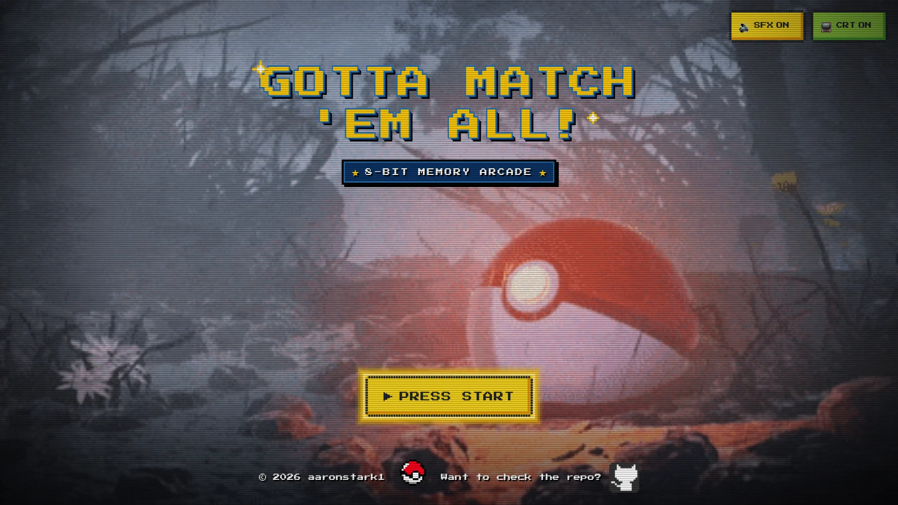
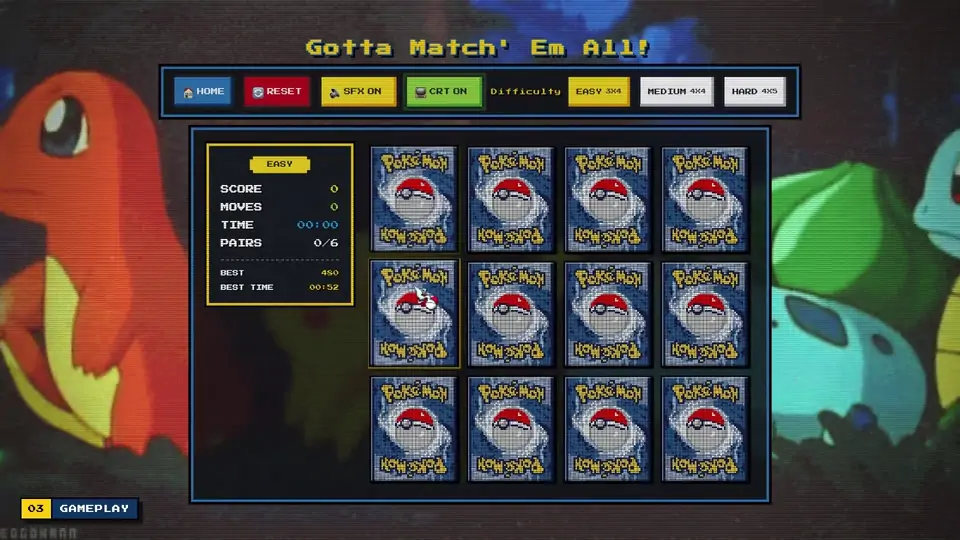
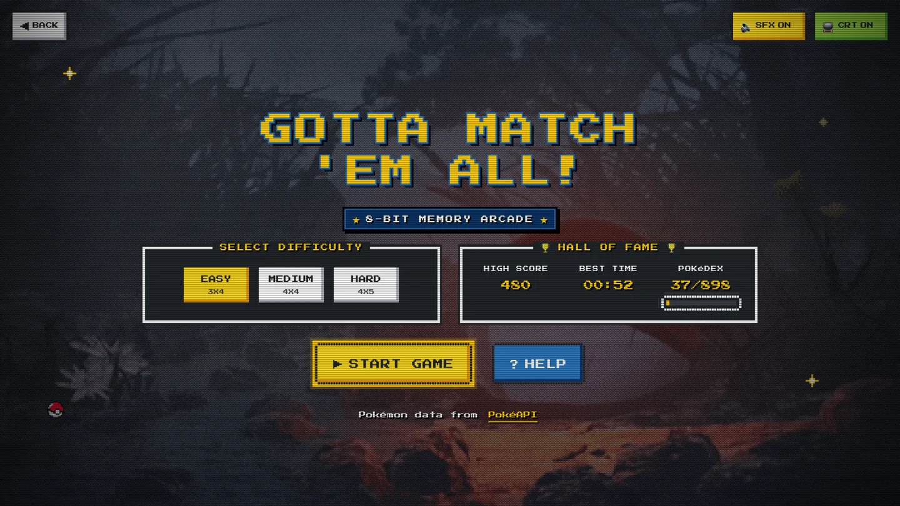
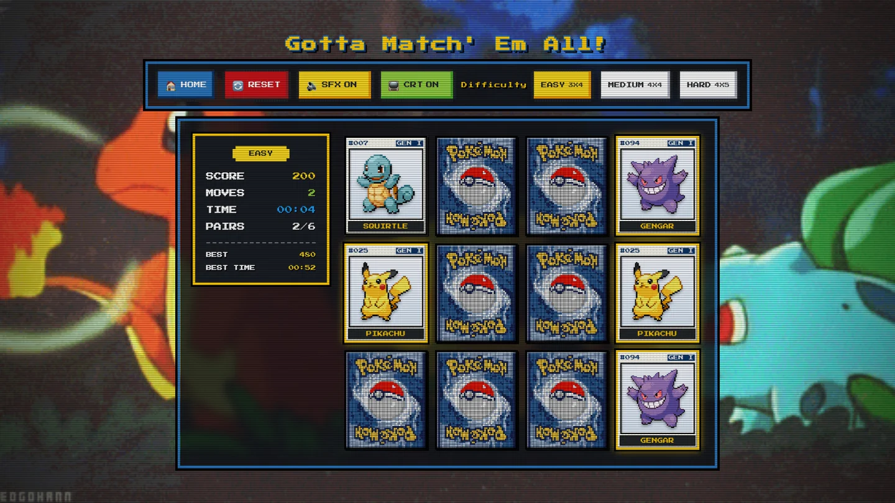
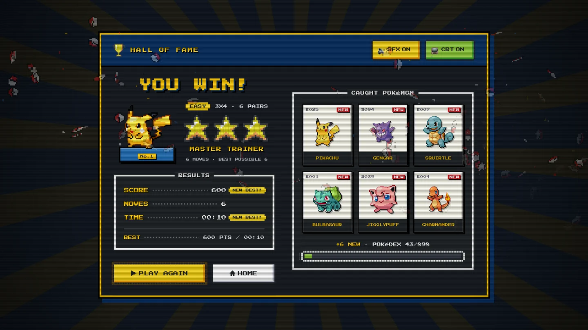
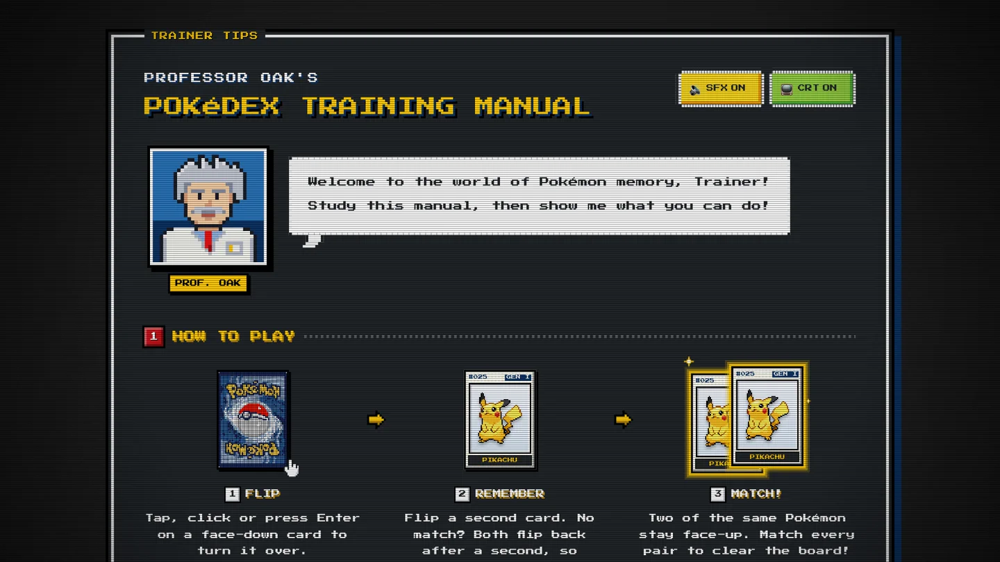
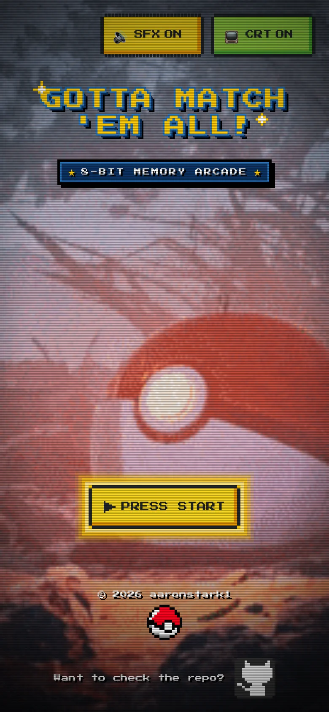
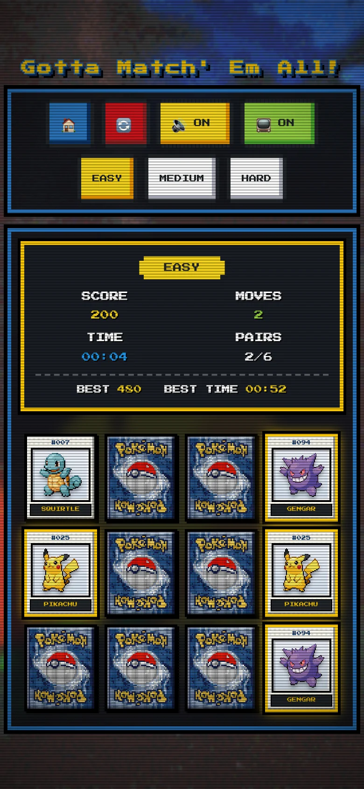
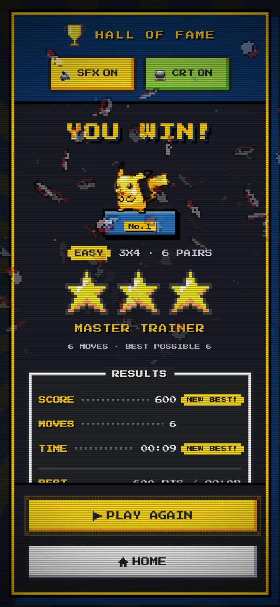
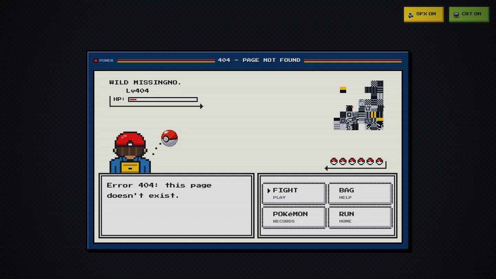

<div align="center">

<a href="https://pokemon-gotta-match-em-all.netlify.app/"></a>

# Gotta Match 'Em All!

**A 90s arcade-style Pokémon memory game for the browser.**<br>
Flip pixel cards, catch matching pairs and chase your best score and time,<br>
with 8-bit sound, a CRT filter, a Hall of Fame and a Pokédex to fill.

<a href="https://pokemon-gotta-match-em-all.netlify.app/"></a>
<a href="https://aaron-correya-portfolio.netlify.app/projects/showcase/pokemon-match-showcase.mp4"></a>


</div>

## See it in action

<p align="center">
  
</p>

<p align="center"><sub>Real gameplay, cut from the <a href="https://aaron-correya-portfolio.netlify.app/projects/showcase/pokemon-match-showcase.mp4">45-second showcase reel</a>: a mismatch, then a match.</sub></p>

## A quick tour

<table>
<tr>
<td width="50%" valign="top">



**Arcade front end.** Press start (or just hit Enter) on the title screen, then pick Easy, Medium or Hard. The Hall of Fame shows your best score, best time and Pokédex progress for that board.

</td>
<td width="50%" valign="top">



**The board.** Real PokéAPI sprites on card faces with their Pokédex number and generation, over one of six animated backdrops. The HUD tracks score, moves, time, pairs and your bests. Sound, the CRT filter and the difficulty can all be switched mid-game.

</td>
</tr>
<tr>
<td width="50%" valign="top">



**Victory.** One to three stars and a trainer title for how few moves you needed, NEW BEST badges, Poké Ball confetti, and a tray of the Pokémon you just caught for your Pokédex.

</td>
<td width="50%" valign="top">



**Professor Oak's manual.** The help page covers flipping, controls, scoring and star ratings, in the game's own style.

</td>
</tr>
</table>

### Plays anywhere

<p align="center">
  &nbsp;
  &nbsp;
  
</p>

The layout reflows from a wide desktop down to a phone in portrait, sized with `100dvh` and the safe-area insets, and taps work just like clicks.

### A 404 worth finding

<table>
<tr>
<td width="55%"></td>
<td>

Take a wrong turn and **a wild MISSINGNO. appears**. The 404 page is a Pokémon battle: the arrow keys move the cursor like in the original games, **FIGHT** starts a game, **BAG** opens the help, **POKéMON** shows your records and **RUN** takes you home.

[Try it on the live site →](https://pokemon-gotta-match-em-all.netlify.app/missingno)

</td>
</tr>
</table>

## How to play

Every two flips count as one move. A matching pair stays face up; anything else flips back. Clear the board in as few moves and as little time as you can.

- **Match a pair:** +100 points.
- **Miss:** −20 points. The score never drops below zero.
- **Clock:** starts on your first flip.
- **Board cleared:** your best score and best time are saved for each difficulty, and the Pokémon you matched join your Pokédex (898 to collect).

| Board | Grid | Pairs | ★★★ Master Trainer | ★★ Great Trainer | ★ Poké Trainer |
| --- | :-: | :-: | :-: | :-: | :-: |
| Easy | 3 × 4 | 6 | 8 moves or fewer | 13 or fewer | any clear |
| Medium | 4 × 4 | 8 | 11 or fewer | 17 or fewer | any clear |
| Hard | 4 × 5 | 10 | 14 or fewer | 21 or fewer | any clear |

| Input | Action |
| --- | --- |
| Click or tap | Flip a card |
| <kbd>Tab</kbd> or the arrow keys | Move between cards |
| <kbd>Enter</kbd> or <kbd>Space</kbd> | Flip the selected card |
| <kbd>Enter</kbd> on the title screen | Press start |
| **SFX** and **CRT** switches | Sound effects and the scanline filter, remembered between visits |

## Built for everyone

- **Keyboard first.** Cards are native buttons, so the whole game plays with Tab, the arrow keys, Enter and Space, with a dashed gold focus ring.
- **Screen readers.** A polite live region announces flips, matches, mismatches and the win. Face-down cards are labelled "Card 3: face down", never by their Pokémon. The win screen and the error box are modal dialogs, and the board stays `inert` while it loads.
- **Reduced motion.** Under `prefers-reduced-motion`, the shakes, pulses, glitches, confetti and blinking are switched off or replaced with still frames. The NEW BEST badge blinks only four times in any case (WCAG 2.2.2).

## How it's built

| Area | Details |
| --- | --- |
| **Stack** | React 19, React Router 7, Vite 7, NES.css 2.3 (bundled from npm), canvas-confetti, Press Start 2P |
| **Data** | [PokéAPI](https://pokeapi.co/): one species-list request, cached in memory and `localStorage`, plus sprites from the PokéAPI sprite repo |
| **Hosting** | Netlify, deployed from `main`. [`public/_redirects`](public/_redirects) serves `index.html` for every route, so `/play` and `/help` survive a refresh |

- **Game logic is a pure reducer.** [`gameReducer.js`](src/game/gameReducer.js) owns every flip. It ignores a second click on the same card, clicks on matched cards and clicks during the mismatch lock, and floors the score at zero. [`usePokemonGame`](src/game/usePokemonGame.js) wires it to the clock, the records and the Pokédex.
- **No pop-in.** Every card's artwork is preloaded and decoded behind the "Catching Pokémon…" loader. If a sprite fails, another Pokémon is swapped in, with a Poké Ball card as the last resort.
- **Sound.** The match chime and victory theme are created lazily on first use. The mismatch buzz has no audio file: it is a square-wave sweep synthesised with the Web Audio API.
- **A CSS CRT.** Scanlines and a vignette in one click-through overlay, drawn above everything, confetti included.
- **Pixel art in code.** Professor Oak, MISSINGNO., the trainer and the icons are SVG sprites built from pixel grids ([`src/components/pixel/`](src/components/pixel)).
- **Fails gracefully.** An error boundary catches render errors, and a retro error box offers Retry and Home if PokéAPI is down.
- **No backend.** Records, the Pokédex and your settings live in `localStorage`.

```text
src/
├── pages/        title, menu, game, help and the 404 battle
├── game/         reducer, usePokemonGame hook, star rating
├── components/   cards, HUD, switches, win screen, help, landing, battle, pixel sprites
├── services/     PokéAPI client and caching
├── audio/        sound provider, lazy audio and the synthesised buzz
├── display/      CRT provider and the reduced-motion hook
├── config/       difficulties, API, backdrops
├── utils/        records, Pokédex, preferences, storage, formatting
└── styles/       per-screen CSS
showcase/         the reel and README media pipeline (Playwright + ffmpeg)
docs/media/       the images in this README
```

## Run it locally

You need Node.js 20.19+ or 22.12+ (Vite 7's minimum).

```bash
git clone https://github.com/AaronStark1/gotta-match-em-all.git
cd gotta-match-em-all
npm install
npm run dev
```

Then open <http://localhost:5173>.

| Command | What it does |
| --- | --- |
| `npm run dev` | Dev server with hot reload |
| `npm run build` | Production build in `dist/` |
| `npm run preview` | Serves the production build locally |
| `npm run lint` | ESLint |

`VITE_SITE_URL` in [`.env`](.env) is the public origin used for the absolute social-preview image URLs. It is set to the live site.

## The showcase reel

The reel and every image in this README come from the real production build, not mock-ups. [`showcase/`](showcase) plays the game in Playwright with a seeded deal and a lived-in save, and wraps it in a "director stage" for the camera moves, callouts and pointer. It then cuts a 1080p MP4 with ffmpeg, with a chiptune soundtrack mixed around the game's own sounds. See [showcase/README.md](showcase/README.md) for how it works.

```bash
cd showcase
npm install
npm run record   # the 45-second reel and its poster (about 2 minutes)
npm run media    # the screenshots and gameplay preview in docs/media
```

## Credits

- Pokémon data and sprites: [PokéAPI](https://pokeapi.co/).
- UI kit: [NES.css](https://nostalgic-css.github.io/NES.css/). Font: [Press Start 2P](https://fonts.google.com/specimen/Press+Start+2P). Confetti: [canvas-confetti](https://github.com/catdad/canvas-confetti).
- Pokémon and all related names and characters are trademarks of Nintendo, Creatures Inc. and GAME FREAK inc. This is a non-commercial fan project, not affiliated with or endorsed by them.

<div align="center">

Made by **Aaron Correya** · [Portfolio](https://aaron-correya-portfolio.netlify.app/) · [GitHub](https://github.com/AaronStark1) · [LinkedIn](https://www.linkedin.com/in/aaron-correya/)

</div>
